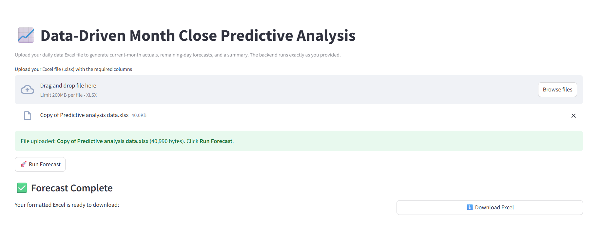
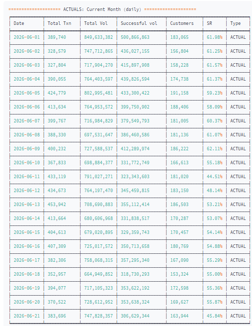
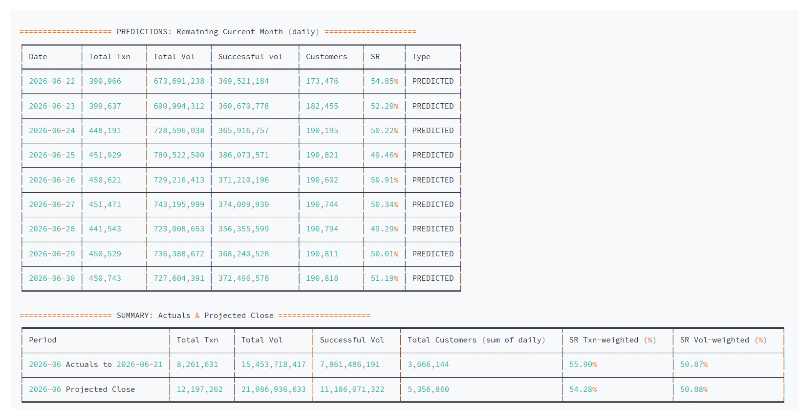

# 📈 Data-Driven Month-Close Forecasting

**Projects where a payments business will close the month — while the month is still running.**

Finance and BI teams need the month-end number before the month ends: for targets, cash planning, and early warnings when success rates slip. This model takes daily payment KPIs, trains gradient-boosting models on the history, forecasts **every remaining day of the current month**, and rolls them up into a **projected month close** for transactions, volume, successful volume, customers and success rate — delivered as a formatted Excel report.


<p align="center">
  
</p>

## ✨ Highlights

- 🔮 **Forecasts every remaining day** of the month for 4 KPIs: transactions, volume, customers, success rate
- 📊 **Projects the month-end close** while the month is still running
- 🧠 **LightGBM / XGBoost / scikit-learn** with automatic engine fallback
- 🛡️ **Stable forecasts:** baseline blending and range clipping stop errors from compounding
- 📁 **Excel in, Excel out:** upload the daily export, get a formatted multi-sheet report

---

## 📸 Screenshots

<table>
  <tr>
    <td align="center"><b>Actual data — month to date</b></td>
    <td align="center"><b>Forecast & projected month close</b></td>
  </tr>
  <tr>
    <td></td>
    <td></td>
  </tr>
</table>

---

## How it works


| Step | Detail |
|---|---|
| **1. Ingest** | Reads the daily Excel export, validates required columns, cleans `1,234` / `87.5%` strings, accepts success rate as % or fraction (or derives it from volume). |
| **2. Features** | Calendar features (weekday, weekend, week of year, month-end, quarter) plus lag and rolling-mean features that **adapt to history length** — works from one week of data upward. |
| **3. Models** | One regressor per KPI. Engine auto-selects **LightGBM → XGBoost → scikit-learn GradientBoosting**, depending on what is installed. Time-ordered train/validation split. |
| **4. Recursive forecast** | Predicts each remaining day to month-end, feeding every forecast back in as history for the next day. |
| **5. Robustness** | Each prediction is **blended with a seasonal baseline** (7-day moving average + weekday average) using weight `exp(-h/14)` — the model is trusted short-term, the baseline further out — then **clipped to the recent 5th–95th percentile** so one bad step can't snowball. |
| **6. Roll-up** | Month-to-date actuals + forecast = projected close, with **transaction-weighted and volume-weighted** success rate. |

## Input

One row per day in an Excel file (`.xlsx`):

| Column | Required | Notes |
|---|---|---|
| `Started Date` | ✅ | Date |
| `Total Txn` | ✅ | Transactions attempted |
| `Total Vol` | ✅ | Value attempted |
| `Successful vol` | ✅ | Value that succeeded |
| `Customers` | ✅ | Daily customers |
| `SR` | optional | Success rate — `87.5` or `0.875`; derived from volume if missing |

## Output

An Excel file `current_month_actuals_and_forecast_<timestamp>.xlsx`:

| Sheet | Contents |
|---|---|
| `Actuals_Current_Month_Daily` | Daily actuals so far this month |
| `Pred_Remaining_Current_Mo` | Daily forecast to month-end |
| `Current_Month_Full_Daily` | Both combined, tagged `ACTUAL` / `PREDICTED` |
| `Summary` | Month-to-date actuals vs **projected month close** |

The console also prints the same tables for a quick check.

## Quick start

```bash
git clone https://github.com/sameedtaj/Data-Driven-Forecasting-model-.git
cd Data-Driven-Forecasting-model-

pip install -r requirements.txt          # or: conda env create -f environment.yml
```

Set your input file and output folder at the top of `main.py`:

```python
FILE_PATH  = r"path\to\your_daily_data.xlsx"
OUTPUT_DIR = r"path\to\output_folder"
```

Run:

```bash
python main.py
```

## Repository

```
├── assets/             # screenshots used in this README
├── main.py             # full pipeline: load → features → models → forecast → Excel
├── requirements.txt    # pip dependencies
└── environment.yml     # conda environment
```

## Design choices

- **Why blend with a baseline?** Recursive ML forecasts compound their own errors. Decaying the model weight with the forecast horizon keeps near-term days sharp and far-term days stable.
- **Why clip?** A guardrail that keeps forecasts inside the recently observed range.
- **Why an engine fallback?** The same script runs on a locked-down work laptop (scikit-learn only) and in a full ML environment (LightGBM / XGBoost).
- **Why weighted success rate?** A simple average of daily SR over-weights quiet days; transaction- and volume-weighted SR match how finance reports it.

## Roadmap

- Walk-forward backtest to report month-close accuracy
- Prediction intervals (quantile regression)
- Holiday, Ramadan and salary-day calendar features
- Streamlit web app with file upload and Excel download

## Author

**Muhammad Sameed** — Data Scientist · [LinkedIn](https://www.linkedin.com/in/muhammad-sameed-4724b81a4) · [GitHub](https://github.com/sameedtaj)
